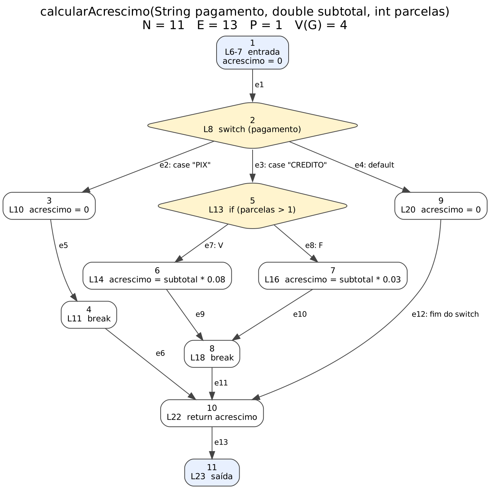
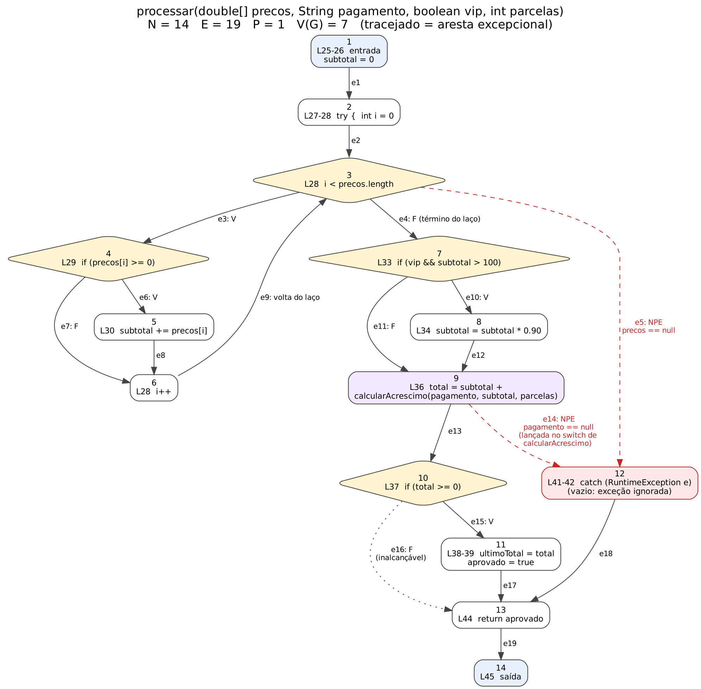

# Atividade individual — Teste de caixa branca e revisão de código-fonte

**Cenário 3 — Processamento de pedidos** (`ProcessadorPedidos`)
Aluno: Nycolas Bertocco · Facens — Análise e Desenvolvimento de Sistemas · Novembro de 2026

---

## Sumário

1. [Introdução e identificação do cenário](#1-introdução-e-identificação-do-cenário)
2. [Instruções de execução](#2-instruções-de-execução)
3. [Análise estática (Etapa 1)](#3-análise-estática-etapa-1)
4. [Grafos de fluxo de controle e convenções](#4-grafos-de-fluxo-de-controle-e-convenções)
5. [Cálculo de V(G) por método](#5-cálculo-de-vg-por-método)
6. [Caminhos básicos independentes](#6-caminhos-básicos-independentes)
7. [Matriz de casos de teste e resultados](#7-matriz-de-casos-de-teste-e-resultados)
8. [Correções implementadas e comparação antes/depois](#8-correções-implementadas-e-comparação-antesdepois)
9. [Limitações](#9-limitações)
10. [Conclusão e referências](#10-conclusão-e-referências)

---

## 1. Introdução e identificação do cenário

Este repositório traz a análise de caixa branca da classe legada `ProcessadorPedidos` (cenário 3). A classe calcula o total de um pedido:

1. soma os preços dos itens (`processar`, laço `for`);
2. aplica 10% de desconto para cliente VIP quando o subtotal passa de 100;
3. soma o acréscimo da forma de pagamento (`calcularAcrescimo`): PIX 0%, crédito à vista 3%, crédito parcelado 8%;
4. guarda o total em `ultimoTotal` e marca `aprovado = true`.

Os dois métodos principais analisados são **`calcularAcrescimo(String, double, int)`** e **`processar(double[], String, boolean, int)`**. O `getUltimoTotal()` não tem grafo, como pede o enunciado. Os dois métodos interagem: `processar` chama `calcularAcrescimo` na linha 36, e uma exceção lançada dentro de `calcularAcrescimo` cai no `catch` de `processar`. Essa interação aparece no grafo de `processar` (aresta e14) e nos testes CT20, CT22, CT23, CT24, CT28 e CT32.

### Estrutura do repositório

```
atividade-caixa-branca/
├── original/ProcessadorPedidos.java      # código-base SEM alterações (referência para grafo e V(G))
├── revisado/ProcessadorPedidos.java      # versão corrigida e comentada
├── testes/
│   ├── MiniTeste.java                    # mini-framework de testes (só JDK, sem dependências)
│   ├── TestesOriginal.java               # 32 casos contra o código original
│   ├── TestesRevisado.java               # 31 casos contra o código revisado
│   ├── run-tests.sh                      # Linux/macOS/Git Bash
│   └── run-tests.bat                     # Windows (cmd/PowerShell)
├── diagramas/
│   ├── cfg_calcularAcrescimo.dot|.png|.svg
│   └── cfg_processar.dot|.png|.svg
├── evidencias/
│   ├── saida_testes_original.txt
│   └── saida_testes_revisado.txt
├── PLANO_DE_TESTE.xlsx                   # aba CAIXA BRANCO (ESTÁTICO) preenchida
└── README.md                             # este relatório
```

> O arquivo `original/ProcessadorPedidos.java` mantém a numeração de linhas do enunciado (a linha 1 é vazia, a classe começa na linha 2). Todas as referências "L.." deste relatório usam essa numeração.

---

## 2. Instruções de execução

**Pré-requisito:** JDK 11 ou superior (`java -version` e `javac -version`). Nenhuma biblioteca externa, Maven ou banco de dados é necessário.

Na raiz do repositório:

```bash
# Linux / macOS / Git Bash
./testes/run-tests.sh
```

```bat
:: Windows
testes\run-tests.bat
```

O script:

1. compila `original/` e `revisado/` em pastas separadas (`build/original`, `build/revisado`), porque as duas classes têm o mesmo nome;
2. compila e executa `TestesOriginal` contra o original — **as falhas são esperadas**, cada uma demonstra um defeito do legado;
3. compila e executa `TestesRevisado` contra o revisado — **todos os casos devem passar**; o script termina com código de saída 0 só nesse caso;
4. grava as saídas em `evidencias/saida_testes_original.txt` e `evidencias/saida_testes_revisado.txt`.

Execução manual equivalente (Linux/macOS; no Windows troque `:` por `;` no classpath):

```bash
javac -encoding UTF-8 -d build/revisado revisado/ProcessadorPedidos.java
javac -encoding UTF-8 -cp build/revisado -d build/testes-revisado testes/MiniTeste.java testes/TestesRevisado.java
java -cp build/revisado:build/testes-revisado TestesRevisado
```

**O que foi realmente executado:** os testes rodaram em 25/11/2026 com OpenJDK 21.0.13 em Linux. O código também foi compilado com `--release 11` (revisado e testes) e `--release 8` (original) para confirmar a compatibilidade. Resultado:

| Suíte | Casos | Passou | Falhou |
|---|---:|---:|---:|
| Original | 32 | 14 | 18 (defeitos do legado) |
| Revisado | 31 | 31 | 0 |

---

## 3. Análise estática (Etapa 1)

A inspeção completa está em **`PLANO_DE_TESTE.xlsx`, aba `CAIXA BRANCO (ESTÁTICO)`**, com 24 ocorrências (E01–E24). Cada linha traz método/linha, trecho, descrição, categoria, severidade com justificativa, risco, recomendação, se foi corrigida e o teste que comprova.

**Resumo por severidade:** 2 críticas · 6 altas · 7 médias · 9 baixas.

### Itens discutidos (checklist do enunciado)

**Documentação, nomenclatura, organização, legibilidade e responsabilidades**
- Não há Javadoc nem comentário de regra de negócio (E01). O único comentário (L42) descreve justamente um defeito: "Exceção ignorada".
- Os nomes são claros e coerentes em português (`subtotal`, `parcelas`, `acrescimo`), mas `processar` devolve um `boolean` cujo significado não está documentado.
- Números mágicos `0.08`, `0.03`, `0.90` e `100` (E11) escondem as regras.
- `processar` acumula soma, filtragem, desconto, acréscimo, aprovação e atualização de estado (E20).
- A classe está no pacote padrão (E02).

**Validação de entrada, estado dos atributos, condições de borda e retornos**
- Nenhum parâmetro é validado: `pagamento` nulo (E05), forma desconhecida ou minúscula aceita com 0% (E06), parcelas ≤ 0 ou acima de qualquer limite (E07), PIX parcelado (E08), subtotal negativo (E09), preços negativos pulados em silêncio (E13), `NaN`/`Infinity` (E14) e pedido vazio aprovado (E15).
- **Estado obsoleto (E18, crítica):** `aprovado` só recebe `true` e nunca volta a `false`. Depois de um pedido aprovado, qualquer chamada que falhe devolve `true`. O teste CT21 prova isso: `processar(null, ...)` retorna `true` porque o pedido anterior foi aprovado.
- Borda do VIP: com subtotal exatamente 100 não há desconto (`> 100`, E21).

**Recursos externos, fechamento e tratamento de exceções**
- A classe não usa arquivo, conexão nem stream (E24: não se aplica).
- **`catch (RuntimeException e)` vazio (E17, crítica):** engole qualquer erro de execução — `NullPointerException` de `precos` nulo (L28), de `pagamento` nulo (lançada em L8, dentro de `calcularAcrescimo`) ou qualquer outra `RuntimeException`. O CT32 usa um *stub* para provar que até uma `IllegalStateException` some.

**Segurança, falhas lógicas, redundâncias e boas práticas**
- Segurança/integridade financeira: escrever `"credito"` em minúsculo zera a taxa do crédito (CT06); forma inexistente (`"BOLETO"`) é aprovada sem acréscimo (CT28); `Infinity` vira um total aprovado (CT27). Não há trilha de auditoria das falhas (E23).
- `double` para dinheiro (E04): `{0.1, 0.2}` resulta em `0.30000000000000004` (CT25).
- **Código morto (E16):** `if (total >= 0)` é sempre verdadeiro nesse fluxo (ver seção 6, caminho P5).
- Atribuições redundantes `acrescimo = 0` (E10).
- Estado mutável sem sincronização (E03).

---

## 4. Grafos de fluxo de controle e convenções

### Convenções adotadas

| Regra | Como foi aplicada |
|---|---|
| Versão de referência | Os dois grafos são do **código original**, antes de qualquer correção. |
| Nós | Cada nó é um comando ou bloco sequencial com uma única entrada e saída. Entrada e saída do método são nós próprios. Os números de linha (L..) aparecem em cada nó. |
| Decisões | `switch`, `if` e a condição do `for` são losangos. O `for` foi dividido em inicialização (`i = 0`), condição (`i < precos.length`) e incremento (`i++`). A saída falsa da condição é o **término do laço**. |
| `break` e `return` | Cada `break` é um nó próprio (nós 4 e 8 de `calcularAcrescimo`) com aresta para o fim do `switch`. Cada `return` é um nó com aresta para a saída. |
| `switch` | Um nó de decisão com uma aresta por `case` e uma para o `default` (k = 3 saídas, ou seja, k − 1 = 2 decisões). O `default` não tem `break`, então segue para o fim do `switch` (aresta e12). |
| Condição composta | `vip && subtotal > 100` foi mantida como **um** nó de decisão (granularidade de comando). Se o curto-circuito do `&&` fosse expandido em dois nós, V(G) de `processar` subiria de 7 para 8. Os testes cobrem as duas condições mesmo assim (CT15, CT16, CT18). |
| `try/catch` | O `try` está no nó 2 de `processar`. O `catch` é o nó 12. |
| **Exceções modeladas** | Duas arestas excepcionais (tracejadas em vermelho) em `processar`: **e5** — `NullPointerException` em `precos.length` quando `precos == null` (nó 3 → 12); **e14** — `NullPointerException` vinda do `switch (pagamento)` de `calcularAcrescimo` quando `pagamento == null` (nó 9 → 12). Foram escolhidas porque são as únicas `RuntimeException` que entradas comuns conseguem provocar. |
| Exceções não modeladas | `ArrayIndexOutOfBoundsException` em `precos[i]` (impossível: o laço respeita `length`), `ArithmeticException` (não ocorre com `double`) e erros da JVM (`Error` não é capturado). No grafo de `calcularAcrescimo`, a NPE do `switch` **não** foi desenhada como aresta: o método não tem `try/catch` e a exceção apenas sai para quem chamou. Ela foi modelada no ponto em que é tratada, a aresta e14 de `processar`. |
| Aresta inviável | e16 (`total >= 0` falso) aparece **pontilhada**: existe na topologia e entra na contagem, mas nenhuma entrada a executa (seção 6). |

### Grafo 1 — `calcularAcrescimo(...)` (linhas 6–23)



| Nó | Linha(s) | Conteúdo |
|---|---|---|
| 1 | 6–7 | entrada; `acrescimo = 0` |
| 2 | 8 | `switch (pagamento)` |
| 3 | 10 | `acrescimo = 0` (case "PIX") |
| 4 | 11 | `break` |
| 5 | 13 | `if (parcelas > 1)` (case "CREDITO") |
| 6 | 14 | `acrescimo = subtotal * 0.08` |
| 7 | 16 | `acrescimo = subtotal * 0.03` |
| 8 | 18 | `break` |
| 9 | 20 | `acrescimo = 0` (default) |
| 10 | 22 | `return acrescimo` |
| 11 | 23 | saída |

**Arestas (13):** e1 1→2 · e2 2→3 (PIX) · e3 2→5 (CREDITO) · e4 2→9 (default) · e5 3→4 · e6 4→10 · e7 5→6 (V) · e8 5→7 (F) · e9 6→8 · e10 7→8 · e11 8→10 · e12 9→10 · e13 10→11.

### Grafo 2 — `processar(...)` (linhas 25–45)



| Nó | Linha(s) | Conteúdo |
|---|---|---|
| 1 | 25–26 | entrada; `subtotal = 0` |
| 2 | 27–28 | `try {`; `int i = 0` |
| 3 | 28 | `i < precos.length` (decisão do laço; pode lançar NPE) |
| 4 | 29 | `if (precos[i] >= 0)` |
| 5 | 30 | `subtotal += precos[i]` |
| 6 | 28 | `i++` |
| 7 | 33 | `if (vip && subtotal > 100)` |
| 8 | 34 | `subtotal = subtotal * 0.90` |
| 9 | 36 | `total = subtotal + calcularAcrescimo(...)` (pode lançar NPE) |
| 10 | 37 | `if (total >= 0)` |
| 11 | 38–39 | `ultimoTotal = total`; `aprovado = true` |
| 12 | 41–42 | `catch (RuntimeException e)` — vazio |
| 13 | 44 | `return aprovado` |
| 14 | 45 | saída |

**Arestas (19):** e1 1→2 · e2 2→3 · e3 3→4 (V) · e4 3→7 (F, término do laço) · **e5 3→12 (NPE)** · e6 4→5 (V) · e7 4→6 (F) · e8 5→6 · e9 6→3 (volta do laço) · e10 7→8 (V) · e11 7→9 (F) · e12 8→9 · e13 9→10 · **e14 9→12 (NPE)** · e15 10→11 (V) · e16 10→13 (F, inviável) · e17 11→13 · e18 12→13 · e19 13→14.

Fontes editáveis dos grafos: `diagramas/*.dot` (Graphviz). Para regerar as imagens: `dot -Tpng -Gdpi=150 diagramas/cfg_processar.dot -o diagramas/cfg_processar.png`.

---

## 5. Cálculo de V(G) por método

Fórmula: **V(G) = E − N + 2P**, com P = 1 (cada grafo de método tem um único componente conectado).

| Método | N | E | P | V(G) = E − N + 2P | Verificação por decisões | Verificação por regiões |
|---|---:|---:|---:|---|---|---|
| `calcularAcrescimo` | 11 | 13 | 1 | 13 − 11 + 2 = **4** | `switch` com 3 saídas = 2 + `if` = 1 → 3 + 1 = **4** | 3 regiões internas + 1 externa = **4** |
| `processar` | 14 | 19 | 1 | 19 − 14 + 2 = **7** | nó 3 com 3 saídas (V, F, NPE) = 2; nó 4 = 1; nó 7 = 1; nó 9 com 2 saídas (normal, NPE) = 1; nó 10 = 1 → 6 + 1 = **7** | grafo planar desenhado sem cruzamentos: R = E − N + 2 = **7** (6 internas + 1 externa) |

**Convenções da checagem:**
- **`switch`:** um nó com *k* saídas conta como *k − 1* decisões. O `default` conta como saída, e não existe *fall-through* entre `case` (há `break` em PIX e CREDITO).
- **Fluxos excepcionais:** um nó que pode desviar para o `catch` ganha uma saída extra e, portanto, mais uma decisão. Sem as duas arestas excepcionais, `processar` teria N = 14, E = 17 e **V(G) = 5**. Os testes cobrem os dois cenários.
- **Condição composta:** contada como uma decisão. Contando o `&&` separadamente (McCabe estendido), `processar` teria V(G) = 8.
- **Regiões:** pela fórmula de Euler para grafos planares conexos (R = E − N + 2), o número de regiões coincide com V(G) quando o grafo é desenhado sem cruzamento de arestas, como nos dois diagramas.

---

## 6. Caminhos básicos independentes

Os conjuntos foram montados pelo **método da linha de base de McCabe**: um caminho base e, a partir dele, um caminho para cada decisão invertida. O total bate com V(G) — **não** são todos os caminhos possíveis. Os laços aparecem com 0 e 1 iteração; mais iterações não geram caminhos linearmente novos.

### `calcularAcrescimo` — V(G) = 4

| Caminho | Nós percorridos | Condição de execução | Teste |
|---|---|---|---|
| A1 | 1 → 2 → 3 → 4 → 10 → 11 | `pagamento == "PIX"` | CT01 |
| A2 | 1 → 2 → 5 → 6 → 8 → 10 → 11 | `pagamento == "CREDITO"` e `parcelas > 1` | CT02 (CT05, CT31 na borda) |
| A3 | 1 → 2 → 5 → 7 → 8 → 10 → 11 | `pagamento == "CREDITO"` e `parcelas ≤ 1` | CT03 |
| A4 | 1 → 2 → 9 → 10 → 11 | `pagamento` não nulo e diferente de "PIX"/"CREDITO" | CT04, CT06 |

**Independência:** cada caminho tem arestas que só ele percorre (A1: e2, e5, e6; A2: e7; A3: e8; A4: e4, e12). Logo, nenhum é combinação linear dos outros.

### `processar` — V(G) = 7

Caminho base: P1 (um item válido, sem VIP, PIX).

| Caminho | Nós percorridos | Decisão invertida em relação a P1 | Condição de execução | Teste |
|---|---|---|---|---|
| P1 (base) | 1-2-3-4-5-6-3-7-9-10-11-13-14 | — | 1 preço ≥ 0; sem desconto VIP; pagamento válido | CT11 |
| P2 | 1-2-3-7-9-10-11-13-14 | nó 3: laço com 0 iterações | `precos.length == 0` | CT12 |
| P3 | 1-2-3-4-6-3-7-9-10-11-13-14 | nó 4: falso | 1 preço negativo (ou NaN) | CT13 |
| P4 | 1-2-3-4-5-6-3-7-8-9-10-11-13-14 | nó 7: verdadeiro | `vip == true` e subtotal > 100 | CT15 |
| P5 | 1-2-3-4-5-6-3-7-9-10-13-14 | nó 10: falso | `total < 0` — **inviável** | CT29 (busca) |
| P6 | 1-2-3-12-13-14 | nó 3: exceção (e5) | `precos == null` | CT19, CT21 |
| P7 | 1-2-3-4-5-6-3-7-9-12-13-14 | nó 9: exceção (e14) | `pagamento == null` | CT20, CT22, CT32 |

**Independência:** P3 é o único com e7; P4, o único com e10/e12; P5, com e16; P6, com e5; P7, com e14. P1 e P2 diferem pelo ciclo do laço (e3, e6, e8, e9). Como cada caminho de P3 a P7 tem uma aresta exclusiva, os coeficientes deles em qualquer combinação que gere P1 ou P2 têm de ser zero. E P2 não é múltiplo de P1. O conjunto tem posto 7 = V(G).

**Iterações:** o laço é coberto com 0 (P2), 1 (P1/P3) e 2 iterações misturando os ramos do `if` (CT14, CT25, CT26).

**Por que P5 é inviável:** no código original, `subtotal` só soma valores com `precos[i] >= 0` (então subtotal ≥ 0, ou `+Infinity`). O desconto VIP multiplica por 0,90 (o sinal se mantém), e `calcularAcrescimo` devolve 0 ou `subtotal × taxa positiva` (≥ 0). Logo, `total = subtotal + acréscimo ≥ 0` sempre. `NaN` é descartado pelo `if` do nó 4 e nunca chega ao total. O CT29 gerou **100.000 pedidos aleatórios** (semente fixa 42, com NaN, ±Infinity, ±MAX_VALUE, −0.0, −1e−300, vetores vazios e formas inválidas), e nenhum executou o ramo falso. A decisão é código morto, e 100% de cobertura de ramos de `processar` é impossível no original. Na versão revisada, a decisão foi removida (E16).

---

## 7. Matriz de casos de teste e resultados

**Legenda:** "esperado" é o comportamento correto pelo requisito. No **original**, rejeitar um pedido significa `processar` retornar `false` sem mudar `ultimoTotal`; em `calcularAcrescimo`, uma entrada inválida deveria lançar `IllegalArgumentException`. No **revisado**, toda rejeição lança `IllegalArgumentException` e deixa `isUltimoPedidoAprovado() == false`.
**Pré-condição padrão:** objeto novo (`aprovado = false`, `ultimoTotal = 0`), salvo indicação.
**Evidência:** a linha com o mesmo ID em `evidencias/saida_testes_original.txt` e `evidencias/saida_testes_revisado.txt`, reproduzível com `./testes/run-tests.sh`.

| ID | Método | Caminho | Tipo | Entrada | Esperado | Observado — original | Sit. orig. | Observado — revisado | Sit. rev. |
|---|---|---|---|---|---|---|---|---|---|
| CT01 | calcularAcrescimo | A1 | normal | PIX, 100, 1 | 0.0 | 0.0 | ✅ | 0.0 | ✅ |
| CT02 | calcularAcrescimo | A2 | normal | CREDITO, 100, 3 | 8.0 | 8.0 | ✅ | 8.0 | ✅ |
| CT03 | calcularAcrescimo | A3 | normal | CREDITO, 100, 1 | 3.0 | 3.0 | ✅ | 3.0 | ✅ |
| CT04 | calcularAcrescimo | A4 | inválida | BOLETO, 100, 1 | IllegalArgumentException | 0.0 | ❌ | IAE "Forma de pagamento desconhecida" | ✅ |
| CT05 | calcularAcrescimo | A2 | limite | CREDITO, 100, **2** | 8.0 | 8.0 | ✅ | 8.0 | ✅ |
| CT06 | calcularAcrescimo | A4 | inválida | "credito", 100, 3 | 8.0 | 0.0 | ❌ | 8.0 | ✅ |
| CT07 | calcularAcrescimo | A3 | limite/erro | CREDITO, 100, **0** | IllegalArgumentException | 3.0 | ❌ | IAE "Parcelas devem estar entre 1 e 12" | ✅ |
| CT08 | calcularAcrescimo | A1 | inválida | PIX, 100, 5 | IllegalArgumentException | 0.0 | ❌ | IAE "PIX aceita somente 1 parcela" | ✅ |
| CT09 | calcularAcrescimo | A3 | inválida | CREDITO, **−100**, 1 | IllegalArgumentException | −3.0 | ❌ | IAE "Subtotal não pode ser negativo" | ✅ |
| CT10 | calcularAcrescimo | exceção | erro | **null**, 100, 1 | IllegalArgumentException | NullPointerException | ❌ | IAE "Forma de pagamento é obrigatória" | ✅ |
| CT30 | calcularAcrescimo | A2 | limite/erro | CREDITO, 100, **13** | IllegalArgumentException | 8.0 | ❌ | IAE "Parcelas devem estar entre 1 e 12" | ✅ |
| CT31 | calcularAcrescimo | A2 | limite | CREDITO, 100, **12** | 8.0 | 8.0 | ✅ | 8.0 | ✅ |
| CT11 | processar | P1 | normal | {50}, PIX, false, 1 | true; total 50.0 | true; 50.0 | ✅ | true; 50.0 | ✅ |
| CT12 | processar | P2 | limite | **{}** | rejeitado; total 0.0 | **true**; 0.0 | ❌ | IAE "ao menos 1 item" | ✅ |
| CT13 | processar | P3 | inválida | {−10} | rejeitado; total 0.0 | **true**; 0.0 | ❌ | IAE "item 0 não pode ser negativo" | ✅ |
| CT14 | processar | P1+P3 | inválida | {50, −10} | rejeitado; total 0.0 | **true**; 50.0 | ❌ | IAE "item 1 não pode ser negativo" | ✅ |
| CT15 | processar | P4 | normal | {200}, PIX, **vip** | true; 180.0 | true; 180.0 | ✅ | true; 180.0 | ✅ |
| CT16 | processar | P1 | limite | {**100**}, PIX, vip | true; 100.0 (sem desconto) | true; 100.0 | ✅ | true; 100.0 | ✅ |
| CT17 | processar | P4 | limite | {**100.01**}, PIX, vip | true; 90.01 | true; **90.009** | ❌ | true; 90.01 | ✅ |
| CT18 | processar | P1 | normal | {200}, PIX, **vip=false** | true; 200.0 | true; 200.0 | ✅ | true; 200.0 | ✅ |
| CT19 | processar | P6 | erro | precos = **null** | rejeitado; total 0.0 | false; 0.0 (erro escondido) | ✅* | IAE "lista de preços é obrigatória" | ✅ |
| CT20 | processar | P7 | erro | {50}, pagamento = **null** | rejeitado; total 0.0 | false; 0.0 (erro escondido) | ✅* | IAE "Forma de pagamento é obrigatória" | ✅ |
| CT21 | processar | P1 → P6 | estado | pré: {50} aprovado; depois precos = null | rejeitado; total 50.0 | **true**; 50.0 | ❌ | IAE; aprovado=false; 50.0 | ✅ |
| CT22 | processar | P1 → P7 | estado | pré: {50} aprovado; depois {999}, null | rejeitado; total 50.0 | **true**; 50.0 | ❌ | IAE; aprovado=false; 50.0 | ✅ |
| CT23 | processar + calcularAcrescimo | P1 + A2 | integração | {100}, CREDITO, false, 3 | true; 108.0 | true; 108.0 | ✅ | true; 108.0 | ✅ |
| CT24 | processar + calcularAcrescimo | P4 + A3 | integração | {200}, CREDITO, vip, 1 | true; 185.4 | true; 185.4 | ✅ | true; 185.4 | ✅ |
| CT25 | processar | P1 (2 iter.) | precisão | {0.1, 0.2}, PIX | true; 0.3 | true; **0.30000000000000004** | ❌ | true; 0.3 | ✅ |
| CT26 | processar | P3+P1 | inválida | {**NaN**, 50} | rejeitado; total 0.0 | **true**; 50.0 | ❌ | IAE "número finito" | ✅ |
| CT27 | processar | P1 | inválida | {**Infinity**} | rejeitado; total 0.0 | **true**; Infinity | ❌ | IAE "número finito" | ✅ |
| CT28 | processar + calcularAcrescimo | P1 + A4 | inválida | {50}, **BOLETO** | rejeitado; total 0.0 | **true**; 50.0 | ❌ | IAE "Forma de pagamento desconhecida" | ✅ |
| CT29 | processar | P5 | viabilidade | 100.000 pedidos aleatórios | 0 ocorrências de total < 0 | 0 | ✅ | 0 aprovados negativos; 0 erros inesperados | ✅ |
| CT32 | processar (stub) | P7 | test double | stub cujo `calcularAcrescimo` lança `IllegalStateException` | exceção propagada | **false** (exceção engolida) | ❌ | não se aplica (ver seção 8) | — |

\* CT19 e CT20 "passam" no original só porque o objeto é novo (`aprovado` ainda é `false`). Com o mesmo erro depois de um pedido aprovado (CT21 e CT22), o original responde `true`. Isso mostra que o `false` dos CT19/20 é coincidência do estado, não uma validação.

**Testes que comprovam as correções:** CT04, CT06–CT10, CT12–CT14, CT17, CT21, CT22 e CT25–CT28 falham no original e passam no revisado. A cobertura de caminhos básicos é CT01–CT04 (A1–A4) e CT11, CT12, CT13, CT15, CT19 e CT20 (P1–P4, P6, P7), mais a evidência de inviabilidade do P5 (CT29).

### Caminhos que dependem de condições externas e estratégias de simulação (2.6)

| Situação | Dificuldade | Estratégia usada / recomendada |
|---|---|---|
| P5 — `total < 0` | Inviável pelas entradas: nenhuma combinação de parâmetros chega lá. | Busca aleatória com semente fixa (CT29) como evidência. Para forçar o ramo, só alterando o código (por exemplo, um *stub* de `calcularAcrescimo` que devolva acréscimo negativo). Como isso testaria um cenário que o próprio código não produz, a decisão foi **removida** no revisado. |
| Desvio para o `catch` por outra `RuntimeException` (não NPE) | Nenhuma entrada provoca, mas um serviço de taxas real (rede, banco, configuração) poderia falhar. | **Stub por subclasse** (CT32): `calcularAcrescimo` é público e não `final`, então uma subclasse anônima sobrescreve o método e lança `IllegalStateException`. Isso prova que o `catch` engole qualquer erro. Em um projeto com bibliotecas, o mesmo seria feito com um *mock* do Mockito (`doThrow`). |
| Concorrência sobre `ultimoTotal`/`aprovado` (E03) | Depende do escalonamento de threads e não é determinística. | Teste de estresse com `ExecutorService` e várias threads na mesma instância, ou ferramentas como jcstress. Não foi automatizado (seção 9). No revisado, o risco foi mitigado com `synchronized`. |
| Valores especiais (`NaN`, `Infinity`) | Raros na prática; surgem de conversões ou cálculos anteriores. | Induzidos diretamente pelas entradas (CT26, CT27) e misturados na busca do CT29. |

---

## 8. Correções implementadas e comparação antes/depois

Arquivo: `revisado/ProcessadorPedidos.java` (comentado com Javadoc). O original continua intacto em `original/`.

### Correções (por ocorrência da Etapa 1)

| Ocorrência | Correção | Justificativa |
|---|---|---|
| E17, E12, E05 | `catch` vazio **removido**. Entradas inválidas lançam `IllegalArgumentException` com mensagem que diz qual campo está errado. | O enunciado proíbe esconder erros com capturas vazias. Um erro explícito permite ao chamador reagir e registrar a falha. |
| E18, E19, E03 | `ultimoPedidoAprovado = false` logo no **início** de `processar`; novo `isUltimoPedidoAprovado()`; `ultimoTotal` documentado como "total do último pedido aprovado"; métodos `synchronized`. | Uma falha nunca devolve a aprovação de outro pedido (CT21/CT22). |
| E04 | `BigDecimal` (com `BigDecimal.valueOf`) e arredondamento a 2 casas com `RoundingMode.HALF_UP`. | Cálculo monetário exato (CT17, CT25). |
| E06, E08 | `enum FormaPagamento` com conversão que ignora maiúsculas/minúsculas e espaços; texto desconhecido é rejeitado; PIX só com 1 parcela. | Fecha a brecha da taxa (CT06, CT28) e aceita "pix"/"Pix" sem ambiguidade. |
| E07 | Parcelas entre 1 e `MAX_PARCELAS = 12`. | Sem limite, qualquer valor era aceito. 12 é uma **premissa** comum no varejo, registrada na seção 9. |
| E09, E13, E14, E15 | Preços e subtotal devem ser finitos e ≥ 0; pedido precisa ter ao menos 1 item; o pedido **inteiro** é rejeitado se um item for inválido. | Descartar itens em silêncio fazia o total aprovado diferir do pedido enviado. |
| E16 | Decisão `if (total >= 0)` removida. | Era código morto; a garantia agora vem das validações de entrada. |
| E10, E11, E20 | Constantes nomeadas; o cálculo foi dividido em métodos privados (`validarParcelas`, `somarItens`, `valorMonetario`, `acrescimoSobre`, `arredondar`). | Legibilidade e responsabilidades separadas. |
| E21, E22 | Regras mantidas (`> 100` e desconto aplicado antes do acréscimo), agora documentadas e testadas. | Não havia requisito para mudá-las; mudar sem especificação seria alterar a regra de negócio. |

**Decisões de projeto:**
- As **assinaturas públicas foram mantidas** (`String`, `double`, `int`, `double[]` e retornos `double`/`boolean`), para não quebrar quem já chama a classe. O `BigDecimal` é usado internamente.
- `processar` agora só retorna `true`, porque toda rejeição vira exceção. O `boolean` foi mantido para compatibilidade; o estado fica disponível em `isUltimoPedidoAprovado()`.
- `processar` chama o método privado `acrescimoSobre` em vez do `calcularAcrescimo` público. Assim, uma subclasse não consegue alterar o cálculo interno sobrescrevendo um método público. Por isso o CT32 não se aplica ao revisado.

### Comparação original × revisado

| Critério | Original | Revisado |
|---|---|---|
| **Segurança / integridade** | Taxa do crédito evitável com "credito"; forma inexistente aprovada; `Infinity` aprovado. | Formas fechadas em `enum`; valores não finitos e negativos rejeitados. |
| **Confiabilidade** | 18 de 32 casos falham; pode informar aprovação falsa (CT21/22); erros de centavos. | 31 de 31 casos passam; resultado sempre referente ao pedido atual; valores exatos a 2 casas. |
| **Legibilidade** | Sem documentação; números mágicos; método `processar` com várias responsabilidades. | Javadoc, constantes nomeadas, métodos pequenos com nomes descritivos. |
| **Tratamento de erros** | `catch (RuntimeException)` vazio; NPE genérica no método público. | Nenhuma captura; `IllegalArgumentException` com mensagem específica. |
| **Estado** | `aprovado` nunca volta a `false`; sem sincronização. | Estado zerado a cada chamada; métodos `synchronized`. |

### Mudança na complexidade ciclomática

V(G) contado por decisões (condições compostas como 1 decisão; exceções sem `try/catch` não contadas):

| Método | Original | Revisado |
|---|---:|---:|
| `calcularAcrescimo` | 4 | 1 (delega a validação e o cálculo) |
| `processar` | 7 (5 sem arestas excepcionais) | 2 (só `if vip && subtotal > 100`) |
| `getUltimoTotal` | 1 | 1 |
| `isUltimoPedidoAprovado` | — | 1 |
| `FormaPagamento.converter` | — | 4 |
| `acrescimoSobre` | — | 4 (`switch` com 3 saídas + operador ternário) |
| `validarParcelas` | — | 3 |
| `somarItens` | — | 4 |
| `valorMonetario` | — | 3 |
| `arredondar` | — | 1 |
| **Soma da classe** | **12** | **24** |

Os dois métodos principais ficaram **mais simples** (4 → 1 e 7 → 2), mas a complexidade **total da classe dobrou** (12 → 24). Isso é esperado: quase todas as decisões novas são validações que o legado não fazia, e cada uma corresponde a um defeito corrigido. Como o enunciado prevê, melhorar o código não significa reduzir V(G). O importante é que a complexidade agora está em métodos pequenos, testáveis um a um, e não há mais ramos inalcançáveis.

---

## 9. Limitações

- **Framework de testes próprio:** foi usado um mini-framework (`MiniTeste.java`) em vez de JUnit, para que o projeto rode só com o JDK, sem Maven nem download de dependências. Os casos são automatizados e repetíveis, mas não geram relatório de cobertura (JaCoCo). A cobertura de caminhos foi rastreada manualmente na matriz da seção 7.
- **Concorrência não testada:** o risco E03 foi tratado com `synchronized`, mas não há teste automatizado de concorrência.
- **Premissas de negócio:** o limite de 12 parcelas, a rejeição de PIX parcelado, a aceitação de "pix" minúsculo, a rejeição do pedido inteiro com um item inválido e o arredondamento `HALF_UP` são premissas desta revisão, não requisitos do enunciado. Precisariam ser confirmadas com o "cliente".
- **P5 não executado:** o caminho é inviável no original. A evidência (CT29) é estatística (100.000 entradas) e vem acompanhada do argumento analítico da seção 6, não de uma execução do ramo.
- **Pacote padrão mantido (E02):** as classes continuam sem `package` para simplificar a compilação na linha de comando.
- **Granularidade do grafo:** a condição `vip && subtotal > 100` é um só nó. Com o curto-circuito expandido, V(G) de `processar` seria 8.
- **Modelo da planilha:** a aba `CAIXA BRANCO (ESTÁTICO)` segue as colunas pedidas no enunciado. Se o modelo oficial da disciplina tiver colunas em outra ordem, o conteúdo pode ser copiado para ele sem alterações.

---

## 10. Conclusão e referências

A análise de caixa branca mostrou que o `ProcessadorPedidos` funciona no "caminho feliz" (CT01–CT03, CT11, CT15, CT23, CT24), mas falha em quase tudo fora dele. Os dois defeitos críticos — o `catch` vazio e o atributo `aprovado`, que nunca volta a `false` — se combinam: o sistema pode informar como **aprovado** um pedido que falhou (CT21, CT22). A modelagem do grafo também revelou um ramo inalcançável (`total >= 0` falso), que dava uma falsa sensação de validação.

A versão revisada corrige todos os defeitos de severidade alta e crítica, passa nos 31 casos e mantém a mesma API pública. A complexidade total cresceu porque a validação, que antes não existia, agora está explícita e testada.

### Referências

- McCABE, T. J. A Complexity Measure. *IEEE Transactions on Software Engineering*, v. SE-2, n. 4, p. 308–320, 1976.
- WATSON, A. H.; McCABE, T. J. *Structured Testing: A Testing Methodology Using the Cyclomatic Complexity Metric*. NIST Special Publication 500-235, 1996.
- PRESSMAN, R. S.; MAXIM, B. R. *Engenharia de Software: uma abordagem profissional*. 9. ed. Porto Alegre: AMGH, 2021. Cap. "Teste de caixa branca".
- BLOCH, J. *Effective Java*. 3. ed. Addison-Wesley, 2018 (itens sobre `BigDecimal` para valores monetários e sobre não ignorar exceções).
- Oracle. *Java SE API — java.math.BigDecimal*. Documentação oficial.
